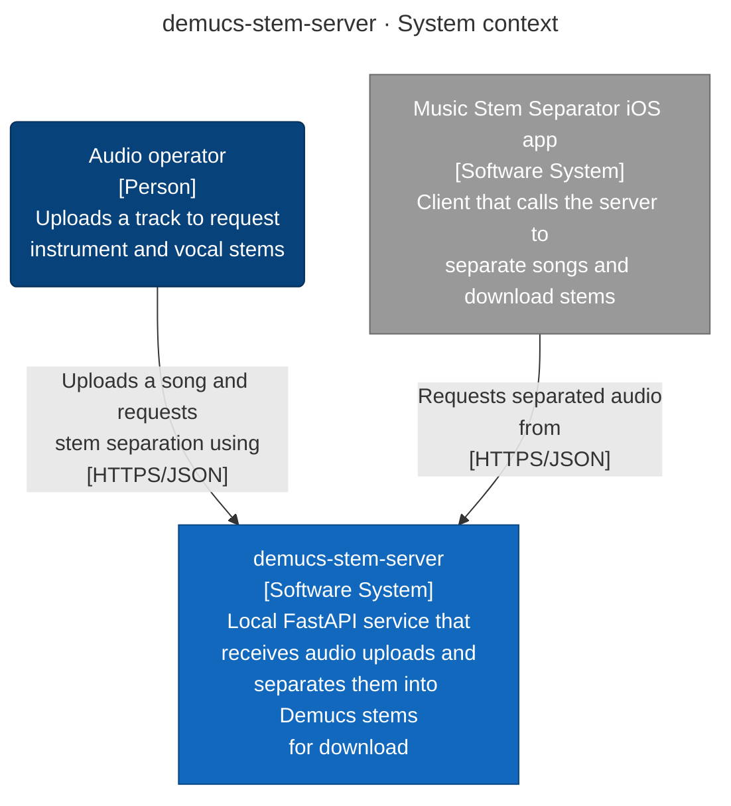
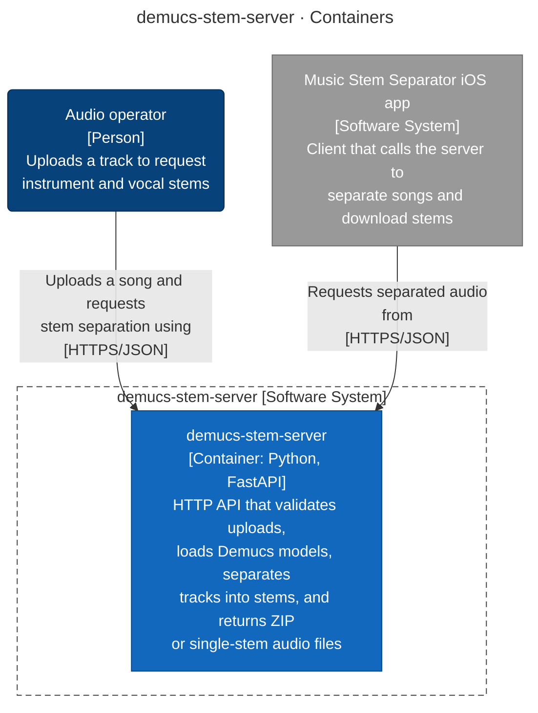
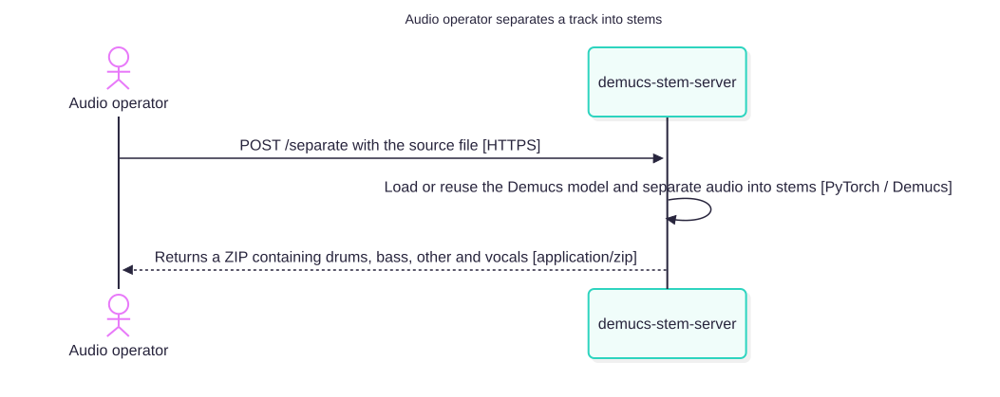
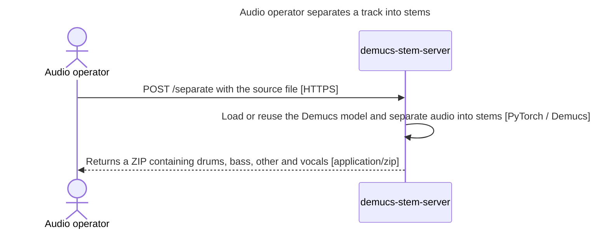
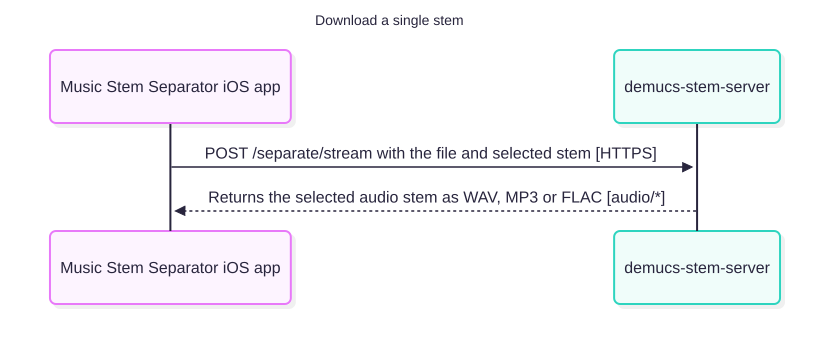
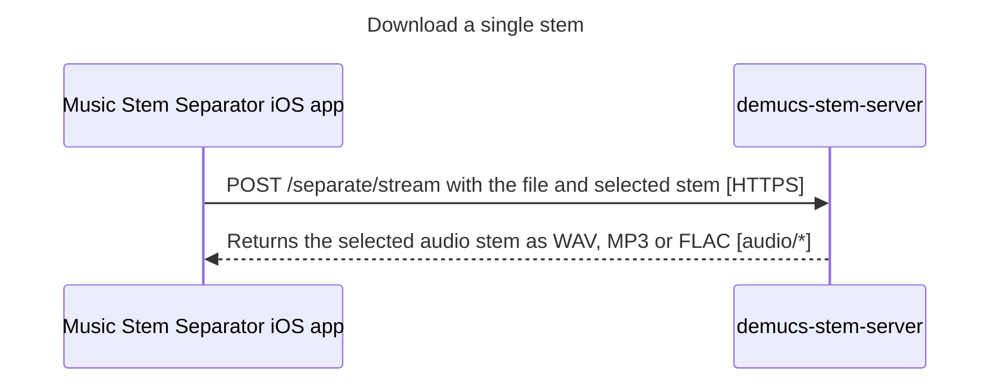
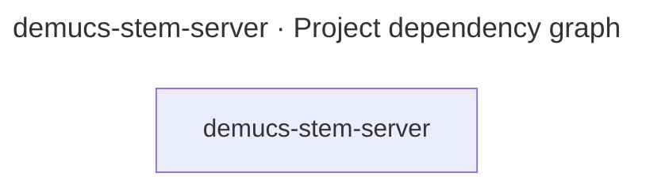

# Architecture Report

## Repository Information

**Repository Name:** demucs-stem-server

**Technology Stack:**

- Python

---

## Executive Summary

[//]: # (summary:start)

Local FastAPI service that receives audio uploads and separates them into Demucs stems for download.

The model of demucs-stem-server describes 1 container, 1 external system, 1 person, 2 relationships and 2 key flows.

[//]: # (summary:end)

The automated dependency checks found no structural concerns.

---

[//]: # (c4:start)

## Architecture overview

demucs-stem-server is a local Python FastAPI service that accepts uploaded audio files and separates them into individual stems using the Demucs ML models. The system is intentionally self-contained: it runs as one container, serves HTTP endpoints, loads models into memory, and returns ZIP archives or single-stem audio files without relying on a separate data store.

### Findings

- The API exposes unauthenticated HTTP endpoints for health checks, model listing, full-stem export, and single-stem streaming (`server.py:200-327`), so anyone with network access to the service can invoke the separation pipeline.
- The server keeps Demucs models in memory across requests (`server.py:42-77`), which reduces latency but also makes startup and memory cost proportional to the loaded model size.
- The container is built as a single service (`Dockerfile:1-17`) and does not define any persistence layer or downstream data store, which matches the repository's local-processing design.

### Recommendations

- Place the service behind an authenticated reverse proxy or firewall when it is exposed beyond a private local network, because the upload endpoints are public by default (`server.py:200-327`).
- Consider explicit GPU or memory sizing in deployment if model caching is expected to handle concurrent users, since the service preloads and keeps models in memory (`server.py:42-77`).

## Architecture (C4 model)

Local FastAPI service that receives audio uploads and separates them into Demucs stems for download

### Diagram key

What the shapes and lines in the diagrams below mean.

| Symbol | Meaning |
|---|---|
| Dark blue rounded box | **Person** — a user or a role outside the system. |
| Blue box (Level 1) | **Software system** — the system this report describes. |
| Blue box | **Container** — an application or service that runs on its own. |
| Grey box | **External system** — run by someone else. |
| Dashed grey outline | The system or the container the diagram is about. |
| Solid arrow | A dependency or a call, labelled with what it does and the technology it uses. |

### Level 1: System context

Mermaid source

### Level 2: Containers

Mermaid source

| Container | Technology | Responsibility | Code |
|---|---|---|---|
| **demucs-stem-server** (container) | Python, FastAPI | HTTP API that validates uploads, loads Demucs models, separates tracks into stems, and returns ZIP or single-stem audio files | `.` |

### Key flows

How a request moves through the system, step by step.

#### Audio operator separates a track into stems

Uploads a source audio file, runs Demucs, and downloads the zipped stems.

Mermaid source

#### Download a single stem

Request one stem from the API for direct playback or export.

Mermaid source

### Deployment

#### Container images

| Dockerfile | Build stages | Runtime image | Exposes | Starts with |
|---|---|---|---|---|
| `Dockerfile` | 1 | `python:3.11-slim` | 8765 | `["python", "server.py"]` |

No CI pipeline or hosting configuration was found in the repository.

### API endpoints

4 HTTP route(s) declared in code.

**demucs-stem-server**

| Method | Path | Declared in |
|---|---|---|
| GET | `/health` | `server.py:200` |
| GET | `/models` | `server.py:209` |
| POST | `/separate` | `server.py:218` |
| POST | `/separate/stream` | `server.py:270` |

### Configuration

| Variable | Default | Used by | Declared in |
|---|---|---|---|
| `DEMUCS_DEVICE` | — | demucs-stem-server | `server.py:60` |
| `DEMUCS_MODEL` | — | demucs-stem-server | `server.py:36` |
| `MAX_UPLOAD_MB` | — | demucs-stem-server | `server.py:35` |
| `PORT` | — | demucs-stem-server | `server.py:37` |

### Technology inventory

Runtime, frameworks and key libraries declared in each container's build files.

| Container | Declared |
|---|---|
| **demucs-stem-server** | `fastapi==0.115.12`, `uvicorn[standard]==0.34.2`, `python-multipart==0.0.20`, `demucs==4.0.1`, `torch>=2.0.0`, `torchaudio>=2.0.0`, `numpy<2.0`, `soundfile>=0.12.0`, `pydub>=0.25.1` |

### Assumptions

Not backed by code evidence; confirm with the team:

- **Audio operator**: Uploads a track to request instrument and vocal stems
- **audio-operator → demucs-stem-server**: Uploads a song and requests stem separation using

### C4 files

- [c4-context.mmd](c4-context.mmd)
- [c4-container.mmd](c4-container.mmd)
- [c4-flow-upload-separate-stems.mmd](c4-flow-upload-separate-stems.mmd)
- [c4-flow-stream-single-stem.mmd](c4-flow-stream-single-stem.mmd)
- [c4-facts.json](c4-facts.json)
- [c4-model.json](c4-model.json)

[//]: # (c4:end)

---

## Architectural Observations

### Strengths

[//]: # (strengths:start)

- Every container, data store and external system found in the code is in the model.
- Every container says what it is responsible for.
- Every component says what it does.
- The model names who the system is for: Audio operator.
- 2 key flows are written down end to end: Audio operator separates a track into stems and Download a single stem.
- Every container and external system points at the code that proves it.
- No circular project references.

[//]: # (strengths:end)

### Concerns

No automated concerns detected.

---

## Recommendations

No changes recommended from the automated checks. Review the diagram for boundaries the checks cannot see.

---

## Appendix: Project Dependency Graph

Every project or module and every reference between them, tests included. The automated checks above (cycles, stray projects, untested projects) are based on this graph.

**Solutions / build roots:** none found

**Project folders:** none

Full dependency graph

### Components

| Project | Ecosystem | Folder | Kind | Depends on | Used by |
|---|---|---|---|---|---|
| demucs-stem-server | Python | - | production | 0 | 0 |

### Dependency Analysis

### demucs-stem-server
- no project references

---

## Generated Artifacts

- [Diagram image (SVG)](dependency-graph.svg)
- C4 diagrams: listed under Architecture (C4 model) above
- [Mermaid source](dependency-graph.mmd)
- [Dependency data (JSON)](dependency-graph.json)
- [Repository scan (JSON)](repository-scan.json)
- [Summary (JSON)](summary.json)

---

## Report Metadata

Generator Version: 3.4.0

